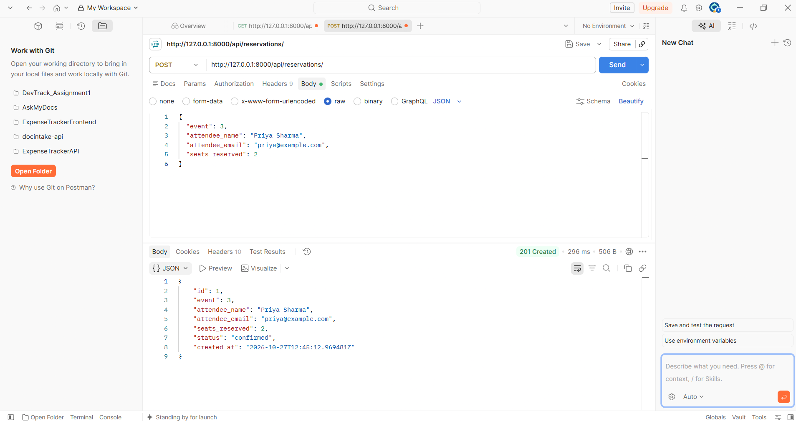
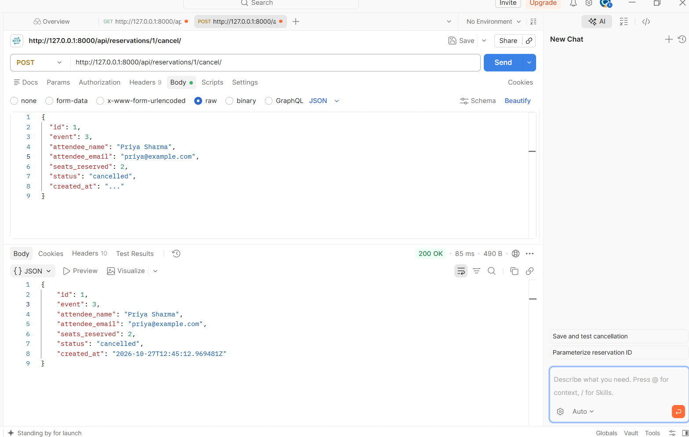
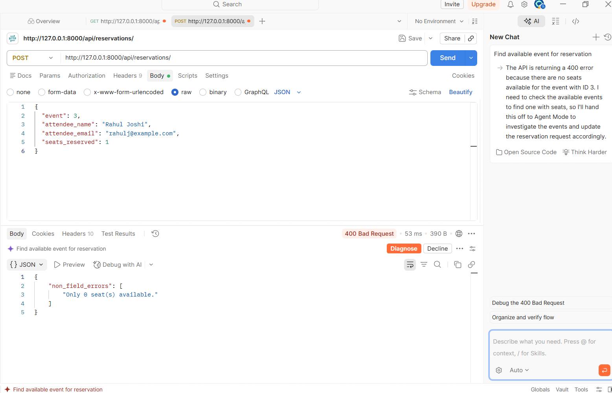

# EventHub API

A Django REST framework project for managing events and seat reservations.

## How to run the project

1. Open a terminal in the project root.
2. Create and activate a virtual environment:

```bash
python -m venv venv
# Windows
venv\Scripts\activate
# macOS/Linux
source venv/bin/activate
```

3. Install the project dependencies:

```bash
pip install -r requirements.txt
```

4. Start the PostgreSQL database using Docker Compose:

```bash
docker-compose up -d
```

5. Run migrations:

```bash
python manage.py migrate
```

6. Start the development server:

```bash
python manage.py runserver
```

The API will be available at:

- http://127.0.0.1:8000/api/

## API endpoints

All routes are under the `/api/` prefix.

### Events

| Method | Endpoint | Description |
| --- | --- | --- |
| GET | `/api/events/` | List all events. Supports filtering by `status` and `venue` query parameters. |
| POST | `/api/events/` | Create a new event. |
| GET | `/api/events/{id}/` | Get a single event by ID. |
| PUT | `/api/events/{id}/` | Update an event. |
| PATCH | `/api/events/{id}/` | Partially update an event. |
| DELETE | `/api/events/{id}/` | Delete an event. |

Example filters:

```bash
GET /api/events/?status=upcoming
GET /api/events/?venue=London
GET /api/events/?status=ongoing&venue=Berlin
```

### Reservations

| Method | Endpoint | Description |
| --- | --- | --- |
| GET | `/api/reservations/` | List all reservations. Supports filtering by `event_id`. |
| POST | `/api/reservations/` | Create a reservation for an event. |
| GET | `/api/reservations/{id}/` | Get one reservation. |
| PUT | `/api/reservations/{id}/` | Update a reservation. |
| PATCH | `/api/reservations/{id}/` | Partially update a reservation. |
| DELETE | `/api/reservations/{id}/` | Delete a reservation. |
| POST | `/api/reservations/{id}/cancel/` | Cancel a reservation and restore the seat count for the event. |

Example filter:

```bash
GET /api/reservations/?event_id=1
```

### Reservation rules

- A reservation cannot be created for an event in `completed` or `cancelled` status.
- The number of seats reserved cannot exceed the event's currently available seats.
- Each successful reservation reduces the event's `available_seats` count.
- Canceling a reservation restores the previously reserved seats back to the event.

## Screenshots

These screenshots are included in the repository and will display directly in GitHub when the README is rendered.







## Design decision

I chose to enforce seat availability at the serializer level and update the event inventory immediately when a reservation is created. This keeps the system consistent and prevents overbooking, because the validation checks the current available seats before saving a reservation and the event's seat count is adjusted right away. That gives the API a clear business rule and reduces the risk of inconsistent inventory data.
